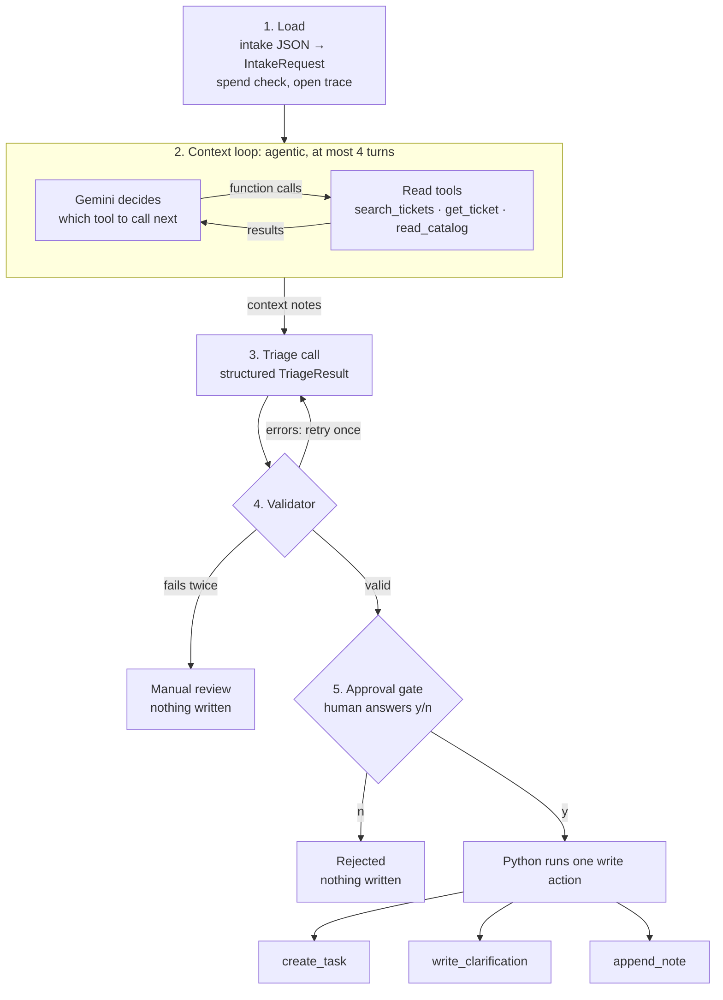

# Analytics Triage Agent

Reads an analytics intake request, gathers context from a ticket board and a data catalog, decides a route, and files one task under the right parent user story once a human approves it.

## How it works

The agent has three kinds of parts:

- **Gemini** (`gemini-3.8-flash` at low thinking) only reasons. It never holds a tool that can change anything.
- **Read-only sources** the model may query during the context loop: the ticket board and the data catalog.
- **Write actions** that only Python executes, after a human approves the result.



Only step 2 lets the model choose what to do next, and only step 5 changes anything outside the run. Every step writes to a trace: one JSON line per run in `traces/<date>.jsonl`, holding a hash of the settings and prompt files, every tool call with its arguments and result, each triage attempt with its validator errors, token usage, cost, latency and the final decision.

### The loop, step by step

1. **Load.** The CLI parses the intake file into an `IntakeRequest`. A spend check refuses to start once the recorded cost of all traces and eval results reaches `MAX_SPEND_USD`.
2. **Context loop.** The model receives the request, fenced and labelled as untrusted data, plus three read-only tools. It decides which to call and in what order, for up to `MAX_CONTEXT_TURNS` (4) turns. The loop ends on the first turn with no tool calls. Tools are switched off on the last turn, so the loop always ends with a summary of at most five sentences: candidate duplicate tickets, relevant catalog entries, and any instructions embedded in the request.
3. **Triage.** A separate call sends the request, the context summary and five few-shot examples (one per route), with the response constrained to the `TriageResult` schema. Keeping it separate from the tool turns makes failures attributable: a wrong duplicate flag traces to step 2, a wrong route to step 3.
4. **Validate.** Deterministic Python checks catch what the schema cannot express. On failure, step 3 reruns once with the error list appended; a second failure marks the request for manual review and nothing is written.
5. **Approve and act.** The terminal shows the full request body, every tool call and what it returned, the context notes, the triage result and the exact action it will take. On `y`, Python executes the route's action:

| Route | Action on approval |
| --- | --- |
| Data Requests, Dashboard Requests, Analytics Requests | Create a task under that parent user story, with the caveats appended as a final paragraph |
| Needs Clarification | Write `drafts/<request_id>_clarify.md` with the question; no ticket |
| Duplicate | Append a "Related request" note to the existing ticket |

### Tools

The model gets three read tools in step 2. They are plain typed Python functions whose docstrings become the tool descriptions the model sees, so each docstring says when to call it. Automatic function calling is off: `pipeline.py` dispatches every call itself, logs it and caps the turns.

| Tool | Arguments | Returns |
| --- | --- | --- |
| `search_tickets` | `query` (≤ 200 chars), `limit` (1–10, default 5) | Tickets ranked by keyword overlap with title and description: ref, title, status, parent story, snippet |
| `get_ticket` | `ref` | One ticket in full: title, description, status, parent story, created date, notes |
| `read_catalog` | `query` (≤ 200 chars) | Up to 5 catalog entries matched by keyword on name and field names: name, type (dashboard or source), owner, refresh cadence, description, key fields |

The dispatcher never raises. An unknown tool name, a bad argument or a missing ticket comes back to the model as an `{"error": ...}` result, so a request that tells the model to call `close_ticket` gets an error, not an action.

The three write actions are not tools. They are Python functions called in step 5, after approval:

| Action | Effect |
| --- | --- |
| `create_task` | Adds a task to the board under the route's parent story, tagged with the primary skill and recording the request id that produced it |
| `append_note` | Adds a note to an existing ticket |
| `write_clarification` | Writes the clarifying question to a Markdown draft |

The board is a JSON file behind a small `Board` interface (`search`, `get`, `create_task`, `append_note`), so a live tracker could replace it without touching the agent.

### Guardrails

- **No write tools for the model.** An injected instruction has nothing to call.
- **Approval gate.** Nothing is written until a human answers `y`. `--auto-approve` exists for evaluation runs, which always use a fresh copy of the seed board.
- **Validator.** The output must parse; fields must match the route (for example, a Duplicate needs `duplicate_of` and no task); the task description must be one paragraph of at most 120 words with no lists; the title must be at most 80 characters; `duplicate_of` must exist on the board; every `catalog_refs` entry must exist in the catalog; caveats must not be blank.
- **Untrusted input.** The request body is fenced with delimiters in both prompts, and `<<<`/`>>>` inside it are neutralised so it cannot close the fence.
- **Bounded reads and spend.** Tool arguments are length-capped and clamped, the context loop is capped at 4 turns, API calls retry only on 429 and 503 with backoff, and runs stop at the spend cap.

### Code map

| Path | Role |
| --- | --- |
| `triage/__main__.py` | CLI: `run`, `batch`, `reset-board` |
| `triage/pipeline.py` | The loop: context, triage, validate, approve, act |
| `triage/llm.py` | The only module that imports `google-genai` |
| `triage/tools.py` | Read tools and their dispatcher |
| `triage/board.py` | `Board` interface and JSON implementation |
| `triage/validator.py` | Deterministic checks on the triage result |
| `triage/approval.py` | Terminal summary and y/n gate |
| `triage/tracing.py` | Traces, cost and the spend cap |
| `triage/render.py`, `triage/prompts/` | Prompt files, few-shot examples and the request fence |
| `triage/schemas.py`, `triage/config.py` | Data model and settings from `.env` |
| `eval/` | Evaluation runner, report and results |
| `data/` | Synthetic intake requests, catalog, seed board and labels |

## Setup

```powershell
python -m venv .venv
.venv\Scripts\python -m pip install -e ".[dev]"
copy .env.example .env   # then add GEMINI_API_KEY
.venv\Scripts\python -m pytest
```
